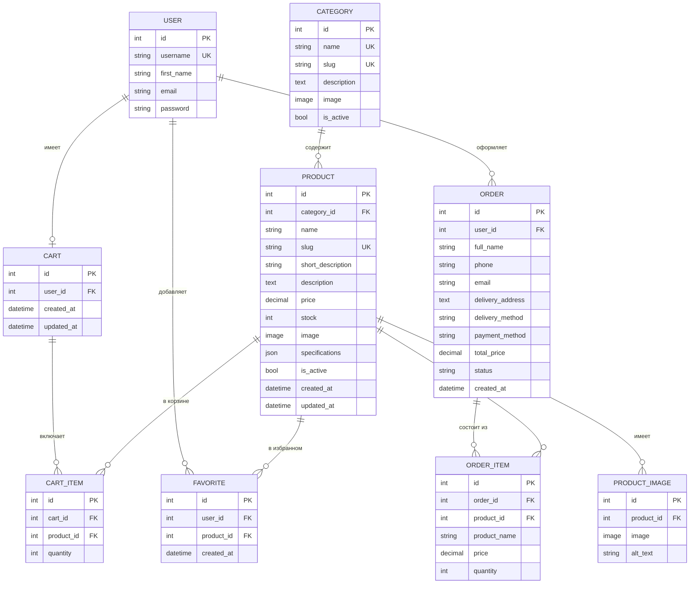

# WILD CAMP

Учебный адаптивный интернет-магазин снаряжения для кемпинга и походов. Проект выполнен в рамках учебной практики.

> Ссылка на макет в Figma: _вставьте ссылку_ (ER-диаграмма, прототипы 375 / 960 / 1200 / 1920 / 2560 px, бизнес-логика, аналитика).

## Содержание
1. [Описание проекта](#1-описание-проекта)
2. [Порядок установки и запуска](#2-порядок-установки-и-запуска)
3. [Аналитическая часть](#3-аналитическая-часть)
4. [База данных](#4-база-данных)
5. [Структура проекта и работа с Git](#5-структура-проекта-и-работа-с-git)

---

## 1. Описание проекта

WILD CAMP — интернет-магазин с каталогом снаряжения (палатки, спальные мешки, рюкзаки, посуда, освещение и инструменты). Покупатель выбирает товары, добавляет их в корзину и избранное и оформляет заказ. Оплата демонстрационная, деньги не списываются. Каталог, остатки и статусы заказов ведутся через панель администратора Django.

### Технологии
- Python 3, Django 5.2 и выше (проверено на Django 6.1)
- SQLite
- HTML5, CSS3, JavaScript без библиотек и фреймворков интерфейса
- Pillow (изображения товаров)
- Git и GitHub, Figma

Сторонние библиотеки интерфейса не используются: вся вёрстка и скрипты написаны вручную.

### Страницы (14)

| Страница | Адрес | Доступ |
|---|---|---|
| Главная | `/` | все |
| Каталог (поиск, фильтры, сортировка, пагинация) | `/catalog/` | все |
| Категория | `/category/<slug>/` | все |
| Карточка товара | `/product/<slug>/` | все |
| Вход | `/login/` | все |
| Регистрация | `/register/` | все |
| О магазине, Контакты | `/about/`, `/contacts/` | все |
| Профиль | `/profile/` | авторизованные |
| Корзина | `/cart/` | авторизованные |
| Оформление заказа | `/checkout/` | авторизованные |
| Заказ | `/orders/<id>/` | авторизованные |
| История заказов | `/orders/` | авторизованные |
| Избранное | `/favorites/` | авторизованные |
| Администрирование | `/admin/` | администратор |

### Функции, связанные с базой данных
1. **Регистрация и авторизация.** Создание пользователя с проверкой надёжности пароля, вход и выход.
2. **Каталог.** Поиск по названию и описанию, фильтр по категории и цене, «только в наличии», сортировка, пагинация по 12 товаров. Параметры сохраняются в адресе.
3. **Корзина.** Добавление, изменение количества (не больше остатка), удаление. Одна корзина на пользователя.
4. **Избранное.** Добавление и удаление товара повторным нажатием.
5. **Оформление заказа.** В одной транзакции проверяется корзина и остатки, создаётся заказ с копией названия и цены, списывается остаток, корзина очищается.
6. **История заказов** и страница заказа со статусом.
7. **Управление данными** (категории, товары, изображения, характеристики, статусы заказов) через Django Admin.

### Адаптив
Макет проверен на ширинах 375, 960, 1200, 1920 и 2560 px.

| Ширина | Контейнер | Товары в каталоге | Особенности |
|---|---|---|---|
| 375 | 343 px | 2 колонки | бургер-меню, фильтры в сворачиваемой панели |
| 960 | 880 px | 3 колонки | полное меню, поиск, «Фильтры» и сортировка в одну строку |
| 1200 | 1120 px | 3 колонки | панель фильтров слева |
| 1920 | 1600 px | 4 колонки | базовый шрифт 18 px |
| 2560 | 2200 px | 5 колонок | базовый шрифт 20 px |

---

## 2. Порядок установки и запуска

Требуется Python 3.12 или новее и Git.

### Windows (PowerShell)
```powershell
git clone <адрес-репозитория>
cd wild_camp
py -m venv venv
.\venv\Scripts\Activate.ps1
pip install -r requirements.txt
python manage.py migrate
python manage.py seed_demo
python manage.py createsuperuser
python manage.py runserver
```

### macOS / Linux
```bash
git clone <адрес-репозитория>
cd wild_camp
python3 -m venv venv
source venv/bin/activate
pip install -r requirements.txt
python manage.py migrate
python manage.py seed_demo
python manage.py createsuperuser
python manage.py runserver
```

Сайт откроется на http://127.0.0.1:8000/, админ-панель — на http://127.0.0.1:8000/admin/ (войдите под созданным суперпользователем).

- `migrate` создаёт таблицы базы данных по файлам миграций, которые лежат в репозитории. Команду `makemigrations` нужно запускать только после изменения моделей.
- `seed_demo` добавляет 5 категорий и 7 демонстрационных товаров. Повторный запуск не создаёт дубликатов.
- Папка `venv/`, файл `db.sqlite3`, `media/` и кэш Python в репозиторий не попадают (см. `.gitignore`).

---

## 3. Аналитическая часть

### 3.1 Для кого сделан сайт
Для туристов, любителей кемпинга и семей, которые выбирают снаряжение для выходных и походов. Это люди 20–45 лет, они часто покупают с телефона и сравнивают несколько товаров перед покупкой.

| Проблема аудитории | Решение на сайте |
|---|---|
| Трудно сравнивать товары | характеристики в карточке, фильтры по цене и наличию, сортировка |
| Покупки с телефона | адаптив от 375 px, фильтры в сворачиваемой панели, крупные кнопки |
| Хочется вернуться к понравившемуся | избранное |
| Страх, что товара нет в наличии | остаток виден в карточке и проверяется при оформлении заказа |
| Потеря выбранных фильтров | параметры каталога сохраняются в адресе и при переходе по страницам |

### 3.2 Бизнес-логика информационной системы

**Участники**

| Роль | Что может |
|---|---|
| Гость | смотреть каталог, категории и карточки товаров, регистрироваться и входить |
| Покупатель | всё, что гость, плюс корзина, избранное, оформление заказа, история заказов, профиль |
| Администратор | управлять категориями, товарами, остатками, фотографиями и статусами заказов через `/admin/` |

**Правила, которые уже реализованы**

1. **Каталог показывает только активные товары** (`is_active = true`). Скрыть товар можно в админ-панели, не удаляя его: история заказов сохранится.
2. **Количество в корзине не больше остатка на складе.** Нельзя добавить больше, чем есть; значение меньше 1 удаляет позицию.
3. **Одна корзина на пользователя**, и один товар встречается в ней только один раз (меняется количество).
4. **Оформление заказа — транзакция.** Заказ создаётся целиком или не создаётся совсем:
   1. проверить, что корзина не пуста;
   2. для каждой позиции проверить, что товар доступен и хватает остатка;
   3. посчитать итог по текущим ценам;
   4. создать заказ со статусом «Новый»;
   5. для каждой позиции списать остаток и сохранить в заказ название и цену на момент покупки;
   6. очистить корзину.
   Если на любом шаге ошибка (товар скрыт, закончился), всё откатывается, остатки не меняются, покупатель видит понятное сообщение.
5. **Жизненный цикл заказа:** Новый → Подтверждён → Собирается → Отправлен → Доставлен (или Отменён). Статус меняет администратор.
6. **Цена и название в заказе фиксируются.** Если позже изменить цену товара, старые заказы не меняются.
7. **Покупатель видит только свои заказы.** Чужой заказ по прямой ссылке не открывается.
8. **Защита данных.** Пароли хранятся в виде хешей, формы защищены CSRF-токеном, изменяющие действия (корзина, избранное, выход) работают только через POST.

**Как логика будет развиваться**

| Этап | Что добавить | Зачем бизнесу |
|---|---|---|
| 1 (сделано) | каталог, корзина, избранное, заказ, роли, админ-панель | минимально работающий магазин |
| 2 | гостевая корзина (в сессии, объединение после входа) | не терять покупателей, которые не хотят регистрироваться сразу |
| 3 | возврат остатка при отмене заказа, история изменения статусов | точный склад и прозрачность для покупателя |
| 4 | отзывы и рейтинг (модель Review, один отзыв на товар от покупателя) | доверие и помощь в выборе |
| 5 | промокоды и скидки | стимулы к покупке, возврат клиентов |
| 6 | email-уведомления о статусе заказа | меньше вопросов в поддержку |
| 7 | реальная оплата через эквайринг и расчёт доставки | настоящие продажи |
| 8 | аналитика в админ-панели: продажи, популярные товары, остатки | управление ассортиментом по данным |

### 3.3 Почему сделано именно так
- **Django и SQLite.** Встроенные авторизация, админ-панель и ORM ускоряют разработку; SQLite не требует отдельного сервера и подходит для учебного проекта. Для реального магазина база заменяется на PostgreSQL без изменения кода.
- **Без библиотек интерфейса.** Это требование задания; вся вёрстка и скрипты написаны вручную.
- **Каталог с боковой панелью на широких экранах.** Фильтры всегда на виду; на узких экранах панель свёрнута, чтобы товары были видны сразу.
- **Снимок цены в заказе.** История заказов не меняется при изменении каталога.
- **Транзакция при оформлении.** Заказ не создаётся наполовину.
- **Корзина только для авторизованных.** Это упрощает связь корзины с пользователем в базе данных; гостевая корзина вынесена на следующий этап.
- **Скрытие вместо удаления товара.** Товар, который попал в заказы, удалять нельзя, поэтому есть флаг `is_active`.

### 3.4 Что не реализовано и почему

| Функция | Причина | Следующий шаг |
|---|---|---|
| Реальная оплата | нужен договор с платёжным сервисом | подключить эквайринг |
| Гостевая корзина | ограничение по времени практики | хранить в сессии и объединять после входа |
| Отзывы и рейтинг | не входят в минимум задания | добавить модель отзывов |
| Галерея и фото товаров на сайте | нет собственных снимков с правами использования; модель `ProductImage` уже есть | загрузить фото через админ-панель и вывести галерею |
| Email-уведомления | нужна почтовая инфраструктура | подключить SMTP |
| Юридические страницы и реквизиты | страницы «О магазине» и «Контакты» пока заготовки | написать тексты, оферту и политику |
| Автоматические тесты | ограничение по времени | покрыть корзину и оформление заказа |

### 3.5 Соответствие законодательству РФ
- Ассортимент не содержит товаров, ограниченных в обороте (оружие, пневматика и т. п.).
- В подвале указано, что проект учебный и не является действующим магазином.
- Для реального запуска необходимо: согласие на обработку персональных данных и политика конфиденциальности (152-ФЗ), публичная оферта, условия доставки и возврата, реквизиты продавца (закон «О защите прав потребителей»).

### 3.6 Метрики успеха (условные)
- доля посетителей, дошедших до корзины;
- доля корзин, завершённых заказом;
- число повторных заказов;
- доля товаров «в наличии».

---

## 4. База данных

Используется реляционная СУБД **SQLite** (файл `db.sqlite3`). Работа с ней идёт через ORM Django: таблицы описаны классами-моделями (`models.py`), по ним `makemigrations` создаёт файлы миграций, а `migrate` применяет их к базе.

### 4.1 ER-диаграмма



Обозначения: `PK` — первичный ключ (уникально определяет строку), `FK` — внешний ключ (ссылка на строку другой таблицы), `UK` — уникальное значение. Связь «один ко многим» (`||--o{`) читается так: одна категория содержит много товаров.

### 4.2 Таблицы и их назначение

Имена таблиц в SQLite строятся как `приложение_модель` (например, `products_product`).

| Таблица | Что хранит | Ключевые поля |
|---|---|---|
| `auth_user` | Пользователи (встроенная таблица Django): покупатели и администраторы | логин (уникален), имя, email, хеш пароля |
| `products_category` | Категории товаров | название и slug (адрес) уникальны, флаг `is_active` |
| `products_product` | Товары | цена, остаток `stock`, характеристики в JSON, флаг `is_active`, связь с категорией |
| `products_productimage` | Дополнительные фотографии товара (галерея) | ссылка на товар, файл, alt-текст |
| `cart_cart` | Корзина пользователя | ровно одна на пользователя |
| `cart_cartitem` | Позиции корзины | корзина, товар, количество |
| `favorites_favorite` | Избранные товары пользователя | пользователь, товар, дата |
| `orders_order` | Заказы | покупатель, контакты и адрес, способы доставки и оплаты, итог, статус |
| `orders_orderitem` | Позиции заказа | заказ, товар, **название и цена на момент покупки**, количество |

Подробнее о важных решениях:
- **`Product.specifications` (JSON).** У разных товаров разные характеристики (у палатки вместимость и сезонность, у фонаря яркость). Вместо десятков пустых столбцов используется одно JSON-поле: ключ — название характеристики, значение — её значение.
- **`Product.stock` и `is_active`.** `stock` — остаток на складе (целое число не меньше 0). `is_active` позволяет скрыть товар, не удаляя его.
- **`Order.status`.** Строка из фиксированного набора: `new`, `confirmed`, `preparing`, `shipped`, `delivered`, `cancelled`.
- **`OrderItem.product_name` и `OrderItem.price`.** Копия данных товара на момент покупки. Если администратор потом переименует товар или изменит цену, старый заказ останется прежним.

### 4.3 Типы связей

| Связь | Тип | Смысл |
|---|---|---|
| `Category` — `Product` | 1 : N | в категории много товаров, у товара одна категория |
| `Product` — `ProductImage` | 1 : N | у товара может быть несколько фотографий |
| `User` — `Cart` | 1 : 1 | у пользователя одна корзина |
| `Cart` — `CartItem` | 1 : N | в корзине много позиций |
| `Product` — `CartItem` | 1 : N | один товар может лежать в корзинах разных людей |
| `User` — `Favorite` — `Product` | M : N через таблицу | пользователь добавляет много товаров, товар есть в избранном у многих |
| `User` — `Order` | 1 : N | у пользователя много заказов |
| `Order` — `OrderItem` | 1 : N | в заказе много позиций |
| `Product` — `OrderItem` | 1 : N | один товар встречается в разных заказах |

Связь «многие ко многим» в реляционной базе не хранится напрямую: её разбивают на две «один ко многим» через промежуточную таблицу. Так устроены `Favorite` (пользователи ↔ товары) и вместе `Cart`/`CartItem` (корзины ↔ товары).

### 4.4 Правила целостности

**Ограничения значений**
- `price ≥ 0` (CHECK-ограничение `product_price_nonnegative`);
- `stock`, `quantity` — неотрицательные целые, `quantity ≥ 1` в корзине и заказе;
- уникальны `Category.name`, `Category.slug`, `Product.slug`, `User.username`;
- пара (`cart`, `product`) уникальна: один товар в корзине один раз;
- пара (`user`, `product`) уникальна: товар не добавляется в избранное дважды.

**Что происходит при удалении (`on_delete`)**

| Связь | Правило | Результат |
|---|---|---|
| `Product.category` | PROTECT | категорию с товарами удалить нельзя |
| `Order.user` | PROTECT | пользователя с заказами удалить нельзя |
| `OrderItem.product` | PROTECT | товар, который был куплен, удалить нельзя (его скрывают через `is_active`) |
| `OrderItem.order` | CASCADE | при удалении заказа удаляются его позиции |
| `Cart.user`, `Favorite.user` | CASCADE | при удалении пользователя удаляются его корзина и избранное |
| `CartItem.cart`, `CartItem.product` | CASCADE | при удалении корзины или товара пропадают позиции корзины |
| `ProductImage.product` | CASCADE | при удалении товара удаляются его фотографии |

Идея: данные, которые нужны для учёта (заказы, купленные товары), защищены от случайного удаления, а временные (корзина, избранное, фото) удаляются вместе с владельцем.

**Индексы.** Django автоматически создаёт индексы для первичных ключей, внешних ключей и уникальных полей, поэтому выборки по категории, пользователю и slug работают быстро.

### 4.5 Как данные меняются в основных сценариях

| Действие | Что происходит в базе |
|---|---|
| Регистрация | `INSERT` в `auth_user` (пароль хранится как хеш) |
| Открытие каталога | `SELECT` из `products_product` с условиями (`is_active`, категория, цена, `stock > 0`), сортировкой и `LIMIT/OFFSET` для страницы |
| «В корзину» | находится или создаётся `cart_cart` пользователя; в `cart_cartitem` создаётся позиция или увеличивается `quantity` (не выше `stock`) |
| «В избранное» | если пары (пользователь, товар) нет в `favorites_favorite`, она создаётся; если есть, удаляется |
| Оформление заказа | в одной транзакции: `INSERT` в `orders_order`; для каждой позиции `UPDATE products_product SET stock = stock - N WHERE stock >= N` и `INSERT` в `orders_orderitem`; затем `DELETE` позиций корзины. При ошибке `ROLLBACK` отменяет всё |
| История заказов | `SELECT` из `orders_order` только по текущему пользователю |

Условие `WHERE stock >= N` в `UPDATE` защищает от ситуации, когда два покупателя одновременно заказывают последний товар: второй `UPDATE` не найдёт подходящей строки, и заказ отменится.

### 4.6 Примеры запросов

На Django ORM (так написано в коде проекта):
```python
# Товары в наличии из категории, от дешёвых к дорогим
Product.objects.filter(category=cat, is_active=True, stock__gt=0).order_by("price")

# Позиции корзины пользователя вместе с товарами (один запрос вместо многих)
cart.items.select_related("product")
```

То же на SQL:
```sql
-- Товары в наличии с названием категории
SELECT p.name, c.name AS category, p.price, p.stock
FROM products_product p
JOIN products_category c ON c.id = p.category_id
WHERE p.is_active = 1 AND p.stock > 0
ORDER BY p.price;

-- Сумма и состав каждого заказа
SELECT o.id, o.status, SUM(i.price * i.quantity) AS total
FROM orders_order o
JOIN orders_orderitem i ON i.order_id = o.id
GROUP BY o.id;

-- Самые популярные товары
SELECT i.product_name, SUM(i.quantity) AS sold
FROM orders_orderitem i
GROUP BY i.product_name
ORDER BY sold DESC;
```

### 4.7 Как посмотреть базу
- через админ-панель Django: `/admin/`;
- консоль: `python manage.py dbshell` (нужна утилита `sqlite3`) или `python manage.py shell` для запросов на ORM;
- программа DB Browser for SQLite: откройте файл `db.sqlite3`.

### 4.8 Почему структура именно такая
- **Данные разнесены по таблицам, ничего не дублируется** (нормализация): название категории хранится один раз, а не в каждом товаре.
- **Заказ и позиции заказа — отдельные таблицы**, потому что в одном заказе может быть любое число товаров.
- **Корзина отдельно от заказа:** корзина изменяется, заказ после оформления фиксируется.
- **Исключение из нормализации сделано намеренно:** название и цена копируются в `OrderItem`, чтобы история покупок не менялась.

---

## 5. Структура проекта и работа с Git

```
wild_camp/
├── config/            настройки и маршруты проекта
├── apps/
│   ├── core/          главная и информационные страницы
│   ├── products/      категории, товары, каталог
│   ├── accounts/      регистрация, вход, профиль
│   ├── cart/          корзина
│   ├── favorites/     избранное
│   └── orders/        оформление и история заказов
├── templates/         HTML-шаблоны
├── static/            CSS и JavaScript
├── manage.py
└── requirements.txt
```

После каждого учебного дня изменения коммитятся и отправляются на GitHub:
```bash
git add .
git commit -m "Краткое описание сделанного за день"
git push
```

### Ограничения учебной версии
- Оплата имитируется, реальные платежи не подключены.
- Фоновое фото в верхнем блоке главной страницы загружается с Unsplash; для публикации замените его изображением с подходящими правами использования.
- Шрифты подключаются с Google Fonts; для работы без интернета их нужно разместить локально.
- Перед коммерческим запуском нужны юридическая проверка документов, безопасные настройки для production (`SECRET_KEY`, `DEBUG`, `ALLOWED_HOSTS`) и аудит обработки персональных данных.
